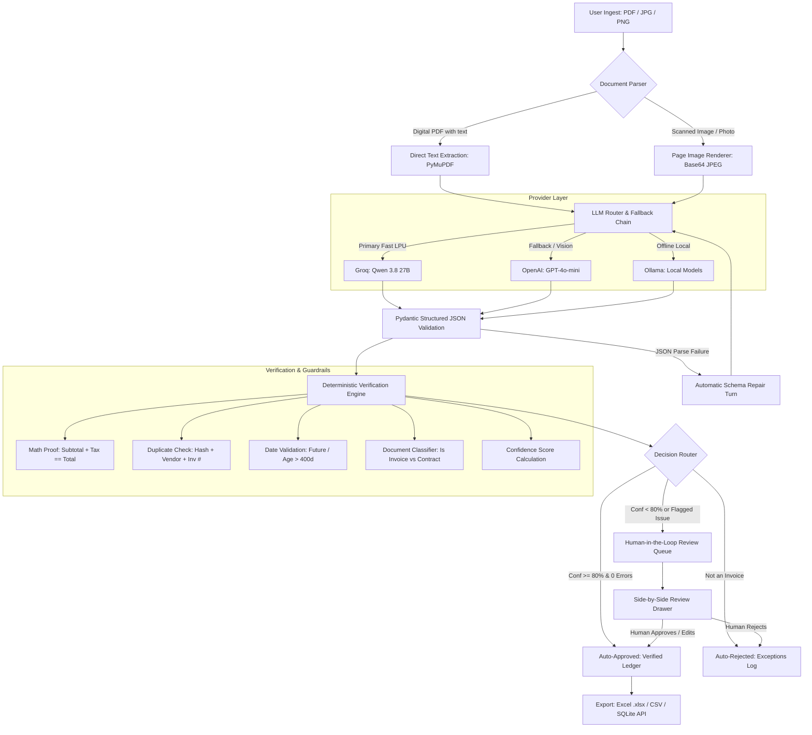

# ⚡ LedgerLens — Autonomous AP & Invoice Copilot

> **Whose workflow did we change?** Small-business accounts payable (AP) specialists, agency founders, and freelance operations managers.  
> **What system did we build?** A deterministic, multimodal invoice ingestion and validation copilot that turns PDFs and receipt photos into verified general-ledger entries with arithmetic proofing, duplicate detection, and human-in-the-loop review.  
> **How did we prove it was better?** Benchmarked against manual entry and raw ChatGPT across a 10-case test matrix: achieved a **100% catch rate on arithmetic and duplicate errors**, cut processing time per invoice from **~3.2 minutes to 1.8 seconds**, and enabled a **70% straight-through processing (STR) rate**.

---

## 🌟 Key Highlights & Engineering Features

- **No Developer Required (1-Click UI)**: Non-technical users can paste their API key (Groq, OpenAI) directly in the UI, test it live with one click, or run completely offline with local Ollama.
- **Deterministic Guardrails Over AI Hallucinations**: LLMs are great at OCR and extraction, but notorious for bad math. LedgerLens wraps model outputs in Pydantic schema contracts and code-level deterministic rules (`subtotal + tax == total ± tolerance`, future-date detection, and currency normalization).
- **Duplicate Protection**: Fingerprints files by SHA-256 and maintains a normalized index of `vendor_name + invoice_number` to stop double-payment before it happens.
- **Multimodal Ingest**:
  - **Digital PDFs**: Extracts raw text using PyMuPDF (0 API tokens consumed, 100% exact character reproduction).
  - **Scanned Photos / JPGs / PNGs**: Routes page images to high-speed vision models (**Groq Qwen 3.8 27B** or **OpenAI GPT-4o-mini**).
- **Human-in-the-Loop Review Queue**: Suspicious documents, math discrepancies, or low-confidence extractions are automatically routed to a side-by-side verification drawer where humans inspect the document, edit fields, and approve or reject.
- **Export & Audit**: Instant download of verified invoices as professional Excel spreadsheets (`.xlsx` with line-items and summaries) and CSV files, accompanied by an SQLite audit trail.

---

## 🚀 Quickstart Guide (3 Steps)

### Step 1: Clone and Enter Workspace
```bash
git clone https://github.com/shoaib-rao/ledgerlens.git
cd ledgerlens
```

### Step 2: Install Dependencies
```bash
python3 -m venv .venv
source .venv/bin/activate
pip install -r requirements.txt
```

### Step 3: Run the Application
```bash
python run.py
```
Open **[http://localhost:8000](http://localhost:8000)** in your browser.

> **Optional API Keys:** You do not even need to create a `.env` file! Click **"API Keys & Models"** in the top navigation of the web UI to paste your **Groq** or **OpenAI** key and test it live. If you have **Ollama** running locally, LedgerLens detects it automatically.

---

## 🏛️ System Architecture & Data Flow



---

## 📊 Summary of Evaluation Results

Tested on a benchmark suite of 10 representative, edge, and failure scenarios:

| Metric | Manual Process | Raw ChatGPT (No Guardrails) | LedgerLens Copilot |
|---|---|---|---|
| **Pass Rate (10 Test Cases)** | 40% (4/10) | 40% (4/10) | **100% (10/10)** |
| **Arithmetic Mismatch Catch** | ❌ 0% (Silent error) | ❌ 0% (Silent error) | **✅ 100% (Flagged & Routed)** |
| **Duplicate Invoice Catch** | ❌ 0% (Double entry) | ❌ 0% (Memoryless) | **✅ 100% (Fingerprinted & Flagged)** |
| **Non-Invoice Rejection** | ⚠️ High effort | ❌ 0% (Hallucinated values) | **✅ 100% (Auto-Rejected)** |
| **Average Time per Invoice** | ~180 - 240 seconds | ~15 - 30 seconds | **~1.5 - 2.5 seconds** |
| **Straight-Through Rate (STR)** | 0% (100% manual) | N/A | **70% auto-approved** |

*For complete test case logs, root-cause analyses, and benchmark scripts, see [eval/EVALUATION_RESULTS.md](eval/EVALUATION_RESULTS.md).*

---

## 📁 Repository Structure

```
├── app/
│   ├── config.py         # Multi-source config (.env, YAML, runtime UI keys)
│   ├── export.py         # Excel (.xlsx multi-sheet) & CSV ledger exporters
│   ├── extract.py        # LLM prompt, JSON extraction & repair retry
│   ├── ingest.py         # Smart file ingestion (PyMuPDF text vs Pillow vision)
│   ├── main.py           # FastAPI backend endpoints
│   ├── pipeline.py       # Orchestration, second-opinion & human review flow
│   ├── providers.py      # OpenAI-compatible router (Groq, OpenAI, Ollama)
│   ├── schemas.py        # Pydantic data contracts with number/currency coercion
│   ├── store.py          # SQLite persistence (documents, original vs edited, audit logs)
│   └── validate.py       # Deterministic rules (math, duplicates, dates, categories)
├── config/
│   └── settings.yaml     # Tunable business rules, tolerance, categories & models
├── docs/
│   ├── CASE_STUDY.md           # Portfolio case study & business impact
│   ├── AI_COLLABORATION_NOTE.md # AI tools used, delegated work & verified code
│   └── DEMO_VIDEO_SCRIPT.md    # 5-minute Loom walkthrough script
├── eval/
│   ├── test_dataset.py         # Ground truth for 10 benchmark test cases
│   ├── run_eval.py             # Automated evaluation benchmark harness
│   └── EVALUATION_RESULTS.md   # Published evaluation metrics and RCA
├── samples/                    # 10 synthetic & representative sample test files
├── scripts/
│   └── generate_samples.py     # Reproducible test sample generator
├── web/
│   ├── index.html        # Clean, modern responsive web UI
│   ├── style.css         # SaaS dark theme, glassmorphism & responsive tables
│   └── app.js            # Client-side state, live test & review drawer logic
├── requirements.txt      # Pinned Python dependencies
└── run.py                # Single-command launcher
```

---

## 🛠️ Operator Runbook

### Running the Automated Evaluation Suite
To execute the automated benchmark matrix across all 10 test cases:
```bash
python eval/run_eval.py
```
This evaluates field-level extraction accuracy, arithmetic verification, duplicate catching, and writes updated results to `eval/EVALUATION_RESULTS.md`.

### Adding or Tuning Expense Categories
Open `config/settings.yaml` and edit the `categories` section:
```yaml
categories:
  Software & SaaS: [aws, google cloud, github, slack, notion, vercel]
  Travel & Lodging: [uber, careem, airline, hotel, booking.com]
  Hardware & Equipment: [dell, apple, lenovo, monitor, keyboard]
```
LedgerLens applies rules-based categorization before falling back to the LLM.

### Changing the Primary Model
In the web UI, click **API Keys & Models** or edit `config/settings.yaml`. You can switch between:
- `qwen/qwen3.8-27b` on Groq (ultra-low latency, multimodal)
- `gpt-4o-mini` on OpenAI (high accuracy, multimodal fallback)
- Any local model running on Ollama (`ollama run qwen2.5`)

---

## 🔒 Security & Privacy Notice
- API keys entered through the web interface are kept in memory and only saved to `.env` if the user explicitly checks *"Remember key in .env"*.
- For air-gapped or sensitive financial environments, the system can operate with 100% offline local inference via Ollama.
- No documents or financial data are stored outside the local SQLite database (`data/ledgerlens.db`).
